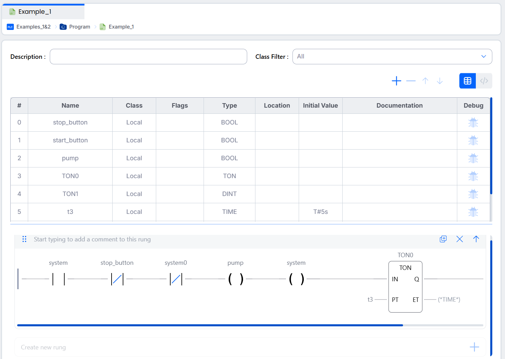

# PLC Practice

Ladder logic exercises built in OpenPLC Editor while learning industrial automation. I'm a mechatronics student at Instituto Tecnológico de Colima (TecNM).

## Tools
- OpenPLC Editor

## Exercises

### 01 - Seal-in start/stop
**What it does:** its a system that turns it self off after five seconds of being turned on

| Type | Name | Description |
|------|------|-------------|
| Input | [start_button] | [an on button] |
| Input | [stop_button] | [a stop button] |
| Output | [motor] | [a water pump] |

**What I learned:** learnd how to use TON´s and seal in circuits.

### 02 - Sumobot attack logic
**What it does:** [atacks when both sensors are true an neglets it if the line sensor detects something]
**What I learned:** [I learned how to implent TON´s on real life situations]
